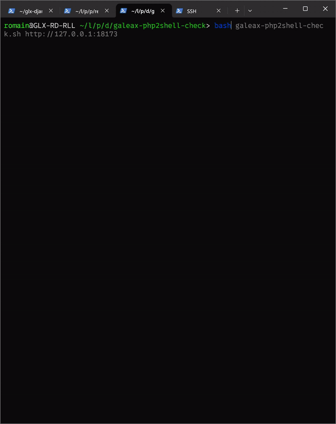
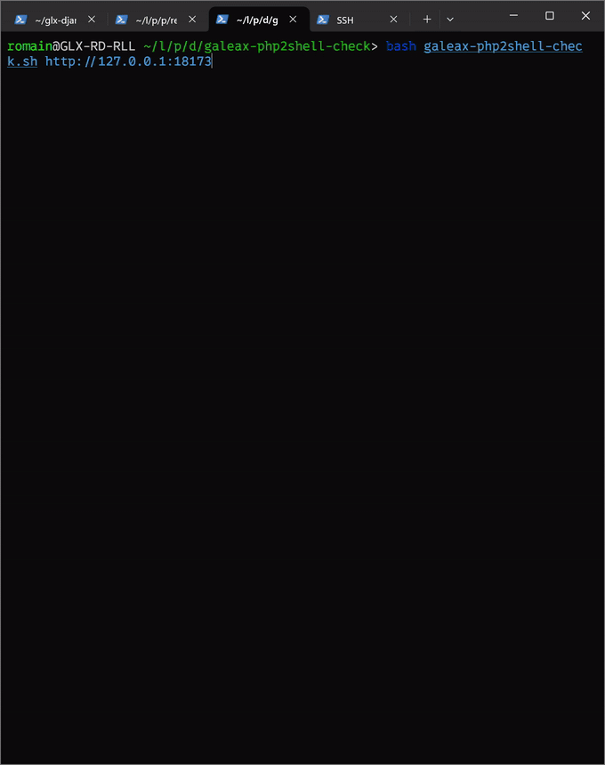
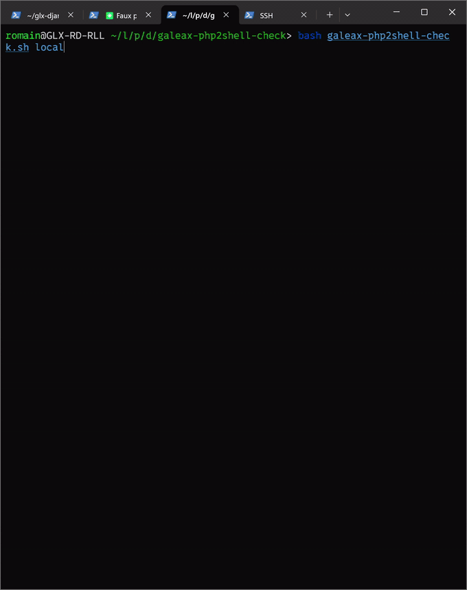
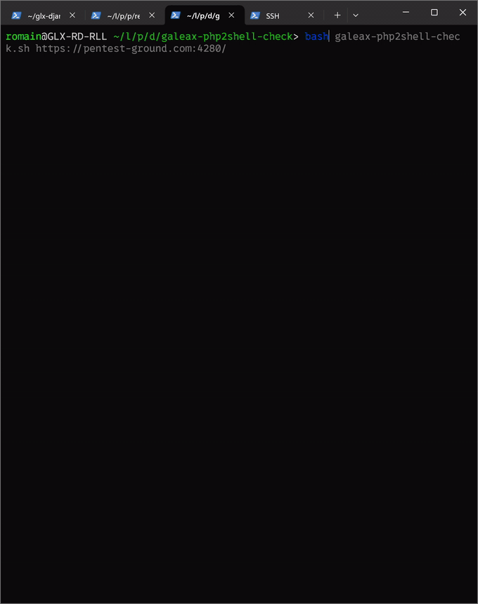

# Galeax — php2shell exposure checker

Vérificateur d'exposition à la vulnérabilité **php2shell**
(**CVE-2026-109618** / **CVE-2026-109619**) — RCE pré-authentification dans le
cœur de PHP, corrigée dans PHP **8.2.35 / 8.3.36 / 8.4.27 / 8.5.12**.

Script autonome, **non-destructif**, sans dépendance. Fourni par Galeax pour que
vous puissiez tester vos propres systèmes.

---

## Prérequis

- `bash` (≥ 4), `curl` (mode web), `grep`/`sed` (présents partout).
- Aucune installation, aucun paquet tiers.

## Autorisation

À n'utiliser que sur des systèmes dont vous êtes **propriétaire** ou sur lesquels vous êtes **explicitement
autorisé** à lancer un test.

---

## Usage

```bash
./galeax-php2shell-check.sh <cible> [options]
```

| Cible | Mode | Exemple |
|---|---|---|
| une **URL** | test à distance (boîte noire) | `./galeax-php2shell-check.sh https://site/` |
| **`local`** | test en local, sur la machine qui exécute le script Bash | `./galeax-php2shell-check.sh local` |

### Options

- **`--deep`** — (à distance) récupération de version par heuristiques : plusieurs
  chemins et méthodes HTTP, plus tentative de leak par page d'erreur.
- **`--active`** — (à distance) ajoute une sonde `post_max_size` (envoie des
  corps HTTP ; à réserver aux environnements de développement, risque de crash).
- **`--crash`** — (à distance) tente de provoquer un crash de la cible : envoie des corps
  multipart piégés (clés imbriquées 62 niveaux, 1 → 8 → 20 Mio) pour obtenir une preuve de la vulnérabilité, même version
  masquée. **INTRUSIF** : peut faire tomber le service (OOM worker) ; ~29 Mio
  envoyés par hôte. À réserver aux environnements de développement, risque de crash. Voir `--sapi`.
- **`--sapi auto|mod_php|fpm`** — filtre les signaux de crash selon le SAPI
  (`mod_php` ignore les signatures propres à FPM comme les 502/503/504, et
  inversement). Valeur par défaut : `auto`.
- **`--path <p>`** (répétable) / **`--path-file <f>`**  : chemins à tester pour la
  sonde de crash (défaut : chemin de l'URL, sinon `/index.php`). Les cibles
  phpMyAdmin entraînent un test sur `/show_config_errors.php`.
- **`-H "Clé: valeur"`** (répétable) — en-tête HTTP custom (auth, cookies…),
  propagé à toutes les requêtes, permet de gérer des scans authentifiés.
- **`--phpinfo <url>`** — lit une page `phpinfo()` exposée (version + config
  autoritatives).
- **`--php <chemin>`** — (mode `local`) binaire PHP précis à tester.
- **`--json`** — sortie machine (CI) · **`--no-color`** · **`-h`** aide.

### Exemples

```bash
./galeax-php2shell-check.sh https://site/ --deep            # à distance, identification poussée
./galeax-php2shell-check.sh https://site/ --deep --active   # + sonde post_max_size pour tests d'exploitation, risque de crash
./galeax-php2shell-check.sh https://site/ --crash           # PROUVE le bug à distance (intrusif, risque de crash)
./galeax-php2shell-check.sh local                           # sur le serveur (test local)
```

> À distance **sans `--crash`**, le verdict repose sur la **version** : fiable
> lorsqu'elle est exposée (en-têtes, `phpinfo`, ou récupérée par `--deep`).
> **`--crash`** va plus loin et **prouve** la corruption mémoire en la déclenchant
> au prix de risques de crash. Pour une certitude non-destructive, utilisez la cible **`local`**.

---

## Démonstrations vidéos

Les quatre cas de détection. Cliquer sur une animation ouvre la vidéo MP4 d'origine :

<table>
  <thead>
    <tr><th></th><th>Local (<code>local</code>)</th><th>À distance (URL)</th></tr>
  </thead>
  <tbody>
    <tr>
      <td align="center"><b>Vulnérable</b></td>
      <td><a href="media/poc/POC_DETECT_VULN_LOCAL.mp4"></a></td>
      <td><a href="media/poc/POC_DETECT_VULN_REMOTE.mp4"></a></td>
    </tr>
    <tr>
      <td align="center"><b>Non vulnérable</b></td>
      <td><a href="media/poc/POC_DETECT_NOT_VULN_LOCAL.mp4"></a></td>
      <td><a href="media/poc/POC_DETECT_NOT_VULN_REMOTE.mp4"></a></td>
    </tr>
  </tbody>
</table>

---

## Interprétation

| Verdict | Signification |
|---|---|
| **VULNÉRABLE** | version/build antérieurs au correctif, branche EOL non corrigée, ou **crash prouvé** via `--crash` |
| **NON VULNÉRABLE** | correctif présent (version ≥ corrigée, symbole du correctif détecté en local, ou CVE corrigée référencée au changelog RPM — rétroportage distro) |
| **EXPOSITION RÉDUITE** | vulnérable mais une mitigation détectée limite le vecteur |
| **INDÉTERMINÉ** | version non obtenue à distance, ou n° de version figé par un rétroportage distro (ex. `7.4.33` sur RHEL) — utiliser `--deep`, `--phpinfo` ou `local` |

**Codes de sortie** : `0` non vulnérable · `1` vulnérable · `2` exposition réduite ·
`3` indéterminé.

## Remédiation

- **Appliquer le correctif PHP** : 8.2.35 / 8.3.36 / 8.4.27 / 8.5.12
- Branches **5.x / 7.x / 8.0 / 8.1** : en fin de vie, **pas de correctif amont** -> **migrer**.
  - **Rétroportages distro** (le n° de version reste souvent figé, invisible en boîte noire) :
    - **7.4** : RHEL 8 -> **7.4.33-8** ([RHSA-2026:87080](https://access.redhat.com/errata/RHSA-2026:87080)) · Debian 11 `7.4.33` (Freexian ELTS) · Ubuntu 20.04 **7.4.3-4ubuntu2.29+esm5** ([USN-8948-1](https://lists.ubuntu.com/archives/ubuntu-security-announce/2026-October/011433.html), Ubuntu Pro/ESM).
    - **8.0** : RHEL 9 -> **8.0.30-8.el9** ([RHSA-2026:87151](https://access.redhat.com/errata/RHSA-2026:87151)) ; AlmaLinux `8.0.30-1.alma.1`. *(php:8.0 sur RHEL 8 est retiré : pas de correctif Red Hat.)*
    - **8.1** : Ubuntu 22.04 -> **8.1.2-1ubuntu2.28** (USN-8948) · RHEL/clones : backports (pas de release amont).
  - Branches **supportées rebasées** (n° déplacé, détecté par la version) : Debian 12 `8.2.35-1~deb12u1` (DLA-4848-1), Debian 13 `8.4.27-1~deb13u1` (DSA-6574-1), Ubuntu 24.04 `8.3.6-0ubuntu0.24.04.13`.
  - Sur les branches EOL figées, **la version seule ne tranche pas** : confirmer en `local` (symbole + changelog `rpm`/`dpkg`). En boîte noire sur un build RHEL/clone ou Debian/Ubuntu, le verdict est **INDÉTERMINÉ** (ni patché ni vulnérable confirmé), jamais « non vulnérable ».
  - **RHEL 7** : affecté uniquement par **CVE-2026-109619** (le code vulnérable à CVE-2026-109618 est absent).
- Durcissement partiel (ces éléments ne remplacent pas le correctif) : `memory_limit=-1`
  non-overridable, `post_max_size` bas, `session.upload_progress.enabled=0`,
  `allow_url_include=Off`, (PHP 8.5) `fatal_error_backtraces=0`.

---

© Galeax - galeax.com - Pour toute question : contact@galeax.com
